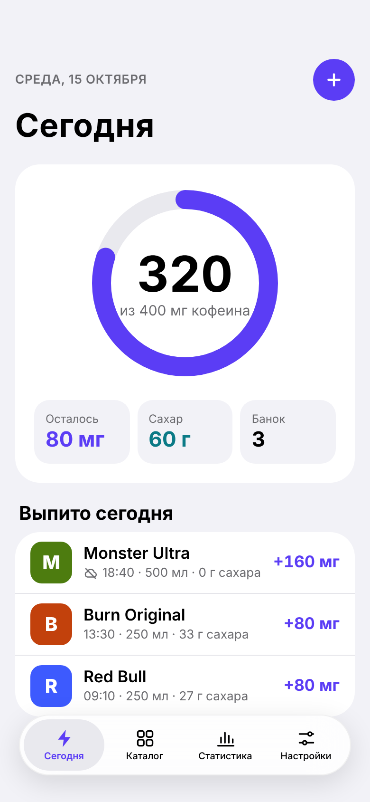
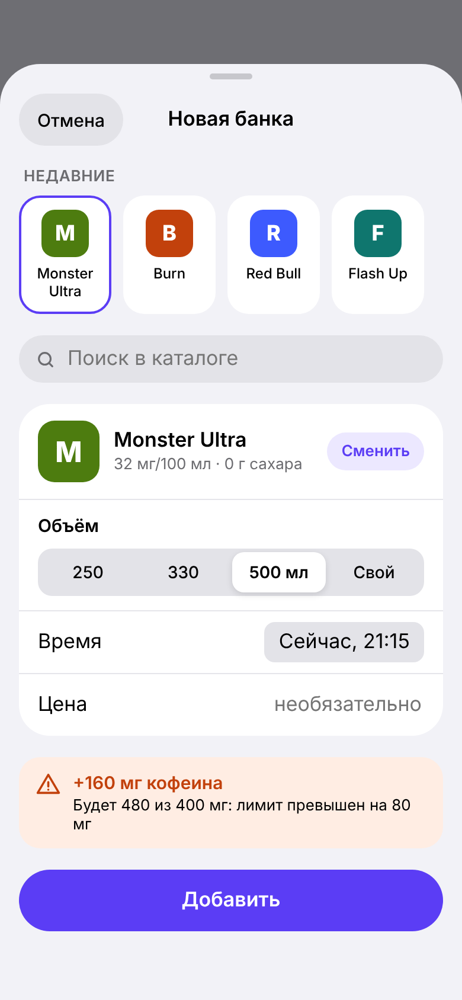
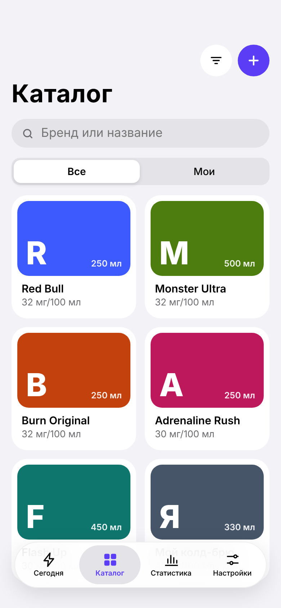
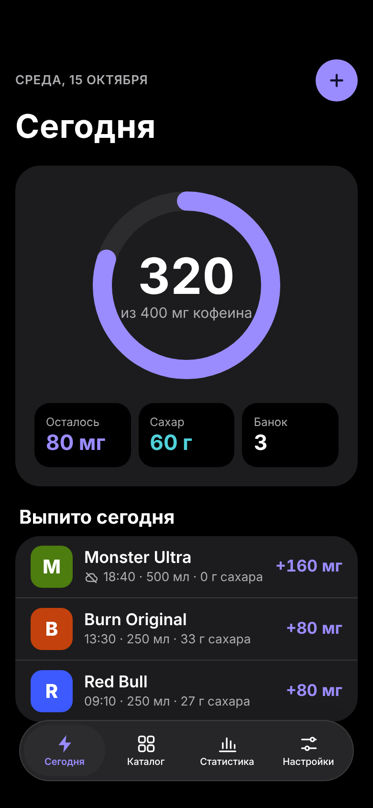

# Buzz ⚡️

**English** · [Русский](README.ru.md)

Buzz is an energy drink tracker for iPhone. Log a can in two taps, see your caffeine and sugar for today, get a warning when you go over your daily limit (400 mg by default), and look at your habits on charts. It works offline and syncs with its own Swift backend.

<p>
  
  
  
  
</p>

## This is a learning project

I am an iOS developer who knows the "classic" stack: UIKit, DiffableDataSource, CompositionalLayout. Buzz is my playground for learning what is new in iOS development: SwiftUI, Observation, SwiftData, Swift Concurrency, Swift Charts, Swift Testing, String Catalogs, Tuist, and server-side Swift with Vapor.

Because of that:

- **The code has a lot of comments.** They are in simple English and explain *what* the code does and *why* it is written this way, often compared with the old UIKit way. In a production app many of them would be too much; here they are the point.
- **Different parts use different architectures on purpose**, to compare them on one app: most features are MVVM on `@Observable`, the "Add" sheet is Clean Architecture, and Settings is a small hand-written Redux.
- **The code was written with [Claude Code](https://claude.com/claude-code) in Claude Code Projects.** The plan, design, docs and code were made together with Claude; I study and change the code by hand afterwards.
- **The first version was not compiled yet.** It was written in a cloud environment without Xcode or Swift, so the first `mise run generate` and build may need small fixes. Those fixes are part of the learning.

## Tech stack

| Area | What is used |
|---|---|
| UI | SwiftUI screens inside UIKit coordinators (`UIHostingController`), Liquid Glass-ready system components |
| State | Observation (`@Observable`, `@State`), a shared `EntryStore` |
| Storage | SwiftData behind repository protocols, `ModelActor` for background work |
| Concurrency | Swift 6 strict concurrency, `async/await`, actors, `AsyncStream`, `Mutex` |
| Charts | Swift Charts: `BarMark`, `RuleMark`, `SectorMark`, `LineMark` |
| Sync | Offline-first: outbox with `pending` state, `actor SyncEngine`, `NWPathMonitor` |
| Languages | English + Russian, String Catalogs (`.xcstrings`) per module, `FormatStyle` for units |
| Tests | Swift Testing (`@Test`, `#expect`, parameterized tests) |
| Backend | Vapor 4, Fluent, SQLite, token auth, error codes instead of texts |
| Shared code | `Shared` Swift package with DTOs, used by the app and the server |
| Tooling | Tuist (project as code), mise (tool versions and tasks), fastlane, GitHub Actions, Renovate, swift-format, SwiftLint |

## Repository layout

```
buzz/
├── iOS/                 the app (Tuist project)
│   ├── Project.swift    targets and modules
│   ├── App/             AppDelegate, SceneDelegate, coordinators, AppDependencies
│   └── Modules/
│       ├── Domain/          models, repository protocols, EntryStore, fakes for previews
│       ├── Persistence/     SwiftData models and repositories
│       ├── Networking/      APIClient on async/await, Keychain, MockAPIClient
│       ├── Sync/            SyncEngine actor, SyncStore, NetworkMonitor
│       ├── DesignSystem/    colors, fonts, CaffeineRing, BrandTile, snack
│       ├── TodayFeature/    MVVM
│       ├── AddEntryFeature/ Clean Architecture (use cases)
│       ├── CatalogFeature/  MVVM
│       ├── StatsFeature/    MVVM + Swift Charts
│       └── SettingsFeature/ Redux
├── Backend/             Vapor server
├── Shared/              DTOs shared by the app and the server
├── Mocks/               catalog and example API JSON
├── docs/                design, architecture, API, study plan (in Russian)
└── mise.toml            tools and tasks
```

Module rules: a feature sees only `Domain` and `DesignSystem`. SwiftData lives only in `Persistence`, the network only in `Networking`. Features do not know about each other or about UIKit; coordinators connect them.

## Getting started

You need a Mac with Xcode 26 (iOS 18+ SDK) and [mise](https://mise.jdx.dev).

```bash
git clone https://github.com/disavle/buzz.git
cd buzz
mise run generate    # installs tuist, ruby, gems, git hook and generates Buzz.xcworkspace
mise run open        # opens the workspace in Xcode
```

Use `mise run generate`, not `mise generate` (that one is a built-in mise command).

Other tasks (`mise tasks` lists all of them):

| Task | What it does |
|---|---|
| `mise run test` | all iOS unit tests via fastlane |
| `mise run lint` | swift-format and SwiftLint |
| `mise run backend:run` | starts the Vapor server on `http://localhost:8080` |
| `mise run backend:test` | backend tests |
| `mise run graph` | draws the module graph |

**Without the backend:** in Xcode, Edit Scheme → Run → Environment Variables, add `BUZZ_MOCK_API = 1`. The app then talks to an in-memory fake server. Without logging in, the app works fully offline anyway.

## Docs

The documentation is in Russian (my native language):

- [Idea and MVP](docs/idea.md)
- [Client: SwiftUI basics](docs/client/README.md), [architecture](docs/client/architecture.md), [architecture experiments](docs/client/architecture-experiments.md), [screens](docs/client/screens.md), [sync](docs/client/sync.md), [localization](docs/client/localization.md)
- [Backend](docs/backend/README.md), [API](docs/backend/API.md), [step by step](docs/backend/STEPS.md)
- [Infrastructure: Tuist, mise, CI](docs/infra/README.md), [hands-on](docs/infra/HANDS-ON.md)
- [Design tokens](docs/design/README.md) and [all screens](docs/design/screens/) (light, dark, English); source of the design canvas in [docs/design/canvas](docs/design/canvas/)
- [Study plan](docs/learning/plan.md) and [handbook of new technologies](docs/learning/handbook.md)

The docs are a snapshot from the day the repository was created. Some code samples in them were written before the real code and may differ from it: the code is the source of truth.

## License

[MIT](LICENSE)
