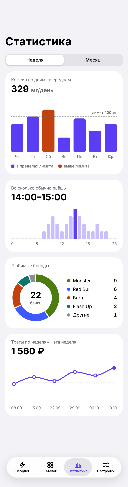
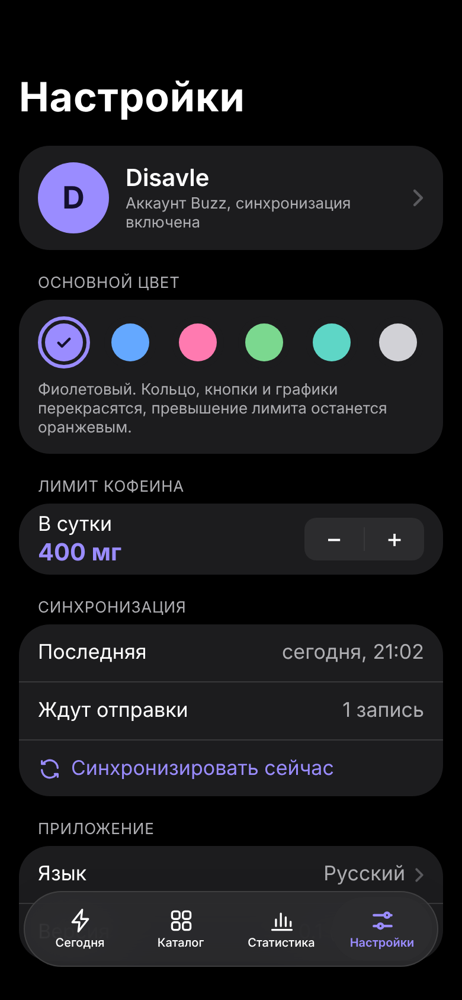

# Buzz ⚡️

[English](README.md) · **Русский**

Buzz — трекер энергетиков для iPhone. Записываешь банку в пару тапов, видишь кофеин и сахар за сегодня, получаешь предупреждение, когда превышаешь дневной лимит (по умолчанию 400 мг), и смотришь на свои привычки на графиках. Работает офлайн и синхронизируется с собственным бэкендом на Swift.

<p>
  
  
  
  
</p>

## Это учебный проект

Я iOS-разработчик со «старым» стеком: UIKit, DiffableDataSource, CompositionalLayout. Buzz — полигон, на котором я изучаю новое в iOS-разработке: SwiftUI, Observation, SwiftData, Swift Concurrency, Swift Charts, Swift Testing, String Catalog, Tuist и серверный Swift на Vapor.

Поэтому:

- **В коде очень много комментариев.** Они на простом английском и объясняют, *что* делает код и *почему* он написан именно так, часто в сравнении с привычным UIKit. В боевом приложении многие были бы лишними, а здесь в них весь смысл.
- **Разные части намеренно сделаны на разных архитектурах**, чтобы сравнить их на одном приложении: большинство фич на MVVM с `@Observable`, шит «Добавить» на Clean Architecture, «Настройки» на маленьком самописном Redux.
- **Код написан с помощью [Claude Code](https://claude.com/claude-code) в Claude Code Projects.** План, дизайн, документацию и код мы делали вместе с Claude; дальше я изучаю и правлю код руками.
- **Первая версия ещё не компилировалась.** Она написана в облачном окружении без Xcode и Swift, поэтому первый `mise run generate` и первая сборка, скорее всего, потребуют мелких правок. Эти правки тоже часть учёбы.

## Стек

| Область | Что используется |
|---|---|
| UI | Экраны на SwiftUI внутри UIKit-координаторов (`UIHostingController`), системные компоненты, готовые к Liquid Glass |
| Состояние | Observation (`@Observable`, `@State`), общий `EntryStore` |
| Хранение | SwiftData за протоколами репозиториев, `ModelActor` для работы в фоне |
| Конкурентность | Строгий режим Swift 6, `async/await`, акторы, `AsyncStream`, `Mutex` |
| Графики | Swift Charts: `BarMark`, `RuleMark`, `SectorMark`, `LineMark` |
| Синхронизация | Offline-first: очередь `pending`, `actor SyncEngine`, `NWPathMonitor` |
| Языки | Английский и русский, свой String Catalog (`.xcstrings`) в каждом модуле, `FormatStyle` для единиц |
| Тесты | Swift Testing (`@Test`, `#expect`, параметризованные тесты) |
| Бэкенд | Vapor 4, Fluent, SQLite локально / Postgres на сервере, авторизация по токену, коды ошибок вместо текстов |
| Общий код | Swift-пакет `Shared` с DTO, его используют и приложение, и сервер |
| Инструменты | Tuist (проект как код), mise (версии инструментов и задачи), fastlane, GitHub Actions, Renovate, swift-format, SwiftLint |

## Структура репозитория

```
buzz/
├── iOS/                 приложение (Tuist-проект)
│   ├── Project.swift    таргеты и модули
│   ├── App/             AppDelegate, SceneDelegate, координаторы, AppDependencies
│   └── Modules/
│       ├── Domain/          модели, протоколы репозиториев, EntryStore, фейки для превью
│       ├── Persistence/     модели и репозитории SwiftData
│       ├── Networking/      APIClient на async/await, Keychain, MockAPIClient
│       ├── Sync/            актор SyncEngine, SyncStore, NetworkMonitor
│       ├── DesignSystem/    цвета, шрифты, CaffeineRing, BrandTile, снек
│       ├── TodayFeature/    MVVM
│       ├── AddEntryFeature/ Clean Architecture (use case-ы)
│       ├── CatalogFeature/  MVVM
│       ├── StatsFeature/    MVVM + Swift Charts
│       └── SettingsFeature/ Redux
├── Backend/             сервер на Vapor
├── Shared/              DTO, общие для приложения и сервера
├── Mocks/               каталог и примеры JSON ответов API
├── docs/                дизайн, архитектура, API, план обучения
└── mise.toml            инструменты и задачи
```

Правила модулей: фича видит только `Domain` и `DesignSystem`. SwiftData живёт только в `Persistence`, сеть только в `Networking`. Фичи не знают друг о друге и про UIKit, их связывают координаторы.

## Как запустить

Нужен Mac с Xcode 26 (SDK iOS 18+) и [mise](https://mise.jdx.dev).

```bash
git clone https://github.com/disavle/buzz.git
cd buzz
mise run generate    # ставит tuist, ruby, гемы, git-хук и генерирует Buzz.xcworkspace
mise run open        # открывает проект в Xcode
```

Именно `mise run generate`, а не `mise generate`: последнее — встроенная команда mise.

Другие задачи (`mise tasks` покажет все):

| Задача | Что делает |
|---|---|
| `mise run test` | все юнит-тесты iOS через fastlane |
| `mise run lint` | swift-format и SwiftLint |
| `mise run backend:run` | запускает Vapor на `http://localhost:8080` |
| `mise run backend:test` | тесты бэкенда |
| `mise run graph` | рисует граф модулей |

**Без бэкенда:** в Xcode Edit Scheme → Run → Environment Variables добавь `BUZZ_MOCK_API = 1`. Тогда приложение работает с фейковым сервером в памяти. А без входа в аккаунт приложение и так полностью работает офлайн.

## Документация

- [Идея и MVP](docs/idea.md)
- [Клиент: основы SwiftUI](docs/client/README.md), [архитектура](docs/client/architecture.md), [эксперименты с архитектурами](docs/client/architecture-experiments.md), [экраны](docs/client/screens.md), [синхронизация](docs/client/sync.md), [локализация](docs/client/localization.md)
- [Бэкенд](docs/backend/README.md), [API](docs/backend/API.md), [по шагам](docs/backend/STEPS.md), [бесплатный деплой: Render + Neon](docs/backend/DEPLOY.md)
- [Инфраструктура: Tuist, mise, CI](docs/infra/README.md), [практика](docs/infra/HANDS-ON.md)
- [Дизайн-токены](docs/design/README.md) и [все экраны](docs/design/screens/) (светлая, тёмная тема, английский); исходники холста в [docs/design/canvas](docs/design/canvas/)
- [План обучения](docs/learning/plan.md) и [справочник по новым технологиям](docs/learning/handbook.md)

Документы — снимок на момент создания репозитория. Какие-то примеры кода в них написаны раньше реального кода и могут от него отличаться: правда в коде.

## Лицензия

[MIT](LICENSE)
